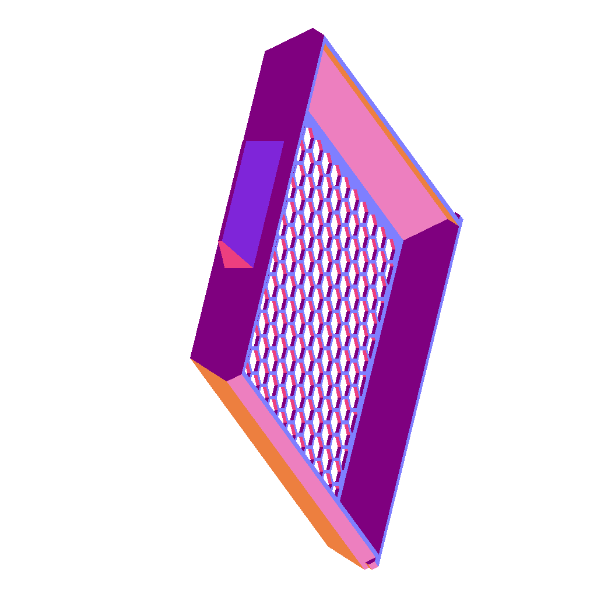
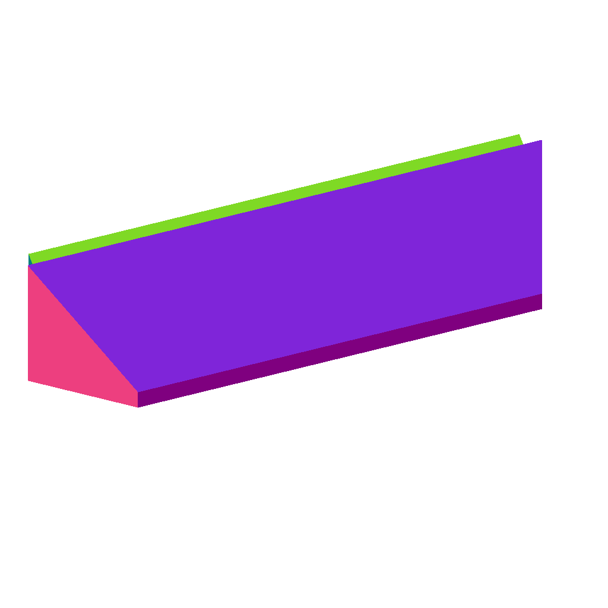

# stl-to-scad-helpers

Tools for an LLM to inspect an STL (or OpenSCAD) model when replicating or
editing it in OpenSCAD:

- **`render_views.py`** renders the model from many camera angles into PNGs,
  one color per surface orientation, for a vision model to eyeball from all sides.
- **`extract_geometry.py`** extracts exact planar-face geometry (normals,
  dimensions, boundary polygons) as JSON. A vision model can't read exact
  dimensions off a picture, so use this for replicating precise measurements
  in OpenSCAD, and keep the renders as a visual sanity check only.

Both accept a `.scad` file too: it's exported to binary STL first via the
`openscad` CLI (must be on `PATH`).

| Full model | Zoomed on one feature (`--focus`) |
| --- | --- |
|  |  |

Each script is a [PEP 723](https://peps.python.org/pep-0723/) single-file
script with its dependencies declared inline — run with `uv run`, no
virtualenv setup needed.

```
uv run render_views.py model.stl --step 30
uv run render_views.py model.stl --focus=-36,36,-223,-206.65,6.5,23  # zoom on one feature
uv run extract_geometry.py model.scad --out geometry.json
uv run extract_geometry.py slice model.stl --origin 0,0,3.1 --normal 0,0,1 --window -10,10,-10,10 --svg cut.svg
```

Each command takes `--help` for its flags. See [`docs/usage.md`](docs/usage.md)
for what the outputs mean (face frames, `section`/`slice`/`compare` fields, how
view-angle filenames decode) and [`SKILL.md`](SKILL.md) for the step-by-step
STL → OpenSCAD replication workflow.

## Installing as a Claude Code skill

Clone this repo into a skills directory Claude Code reads from (e.g.
`~/.claude/skills/stl-to-scad-helpers` or a project's `.claude/skills/`), or
add it as a plugin marketplace/skill source. No build step: the scripts run
as-is via `uv run`.

## Requirements

- Python ≥ 3.10, [`uv`](https://docs.astral.sh/uv/) on `PATH`.
- [`openscad`](https://openscad.org/) on `PATH`, only if you pass a `.scad`
  file instead of an `.stl`.
